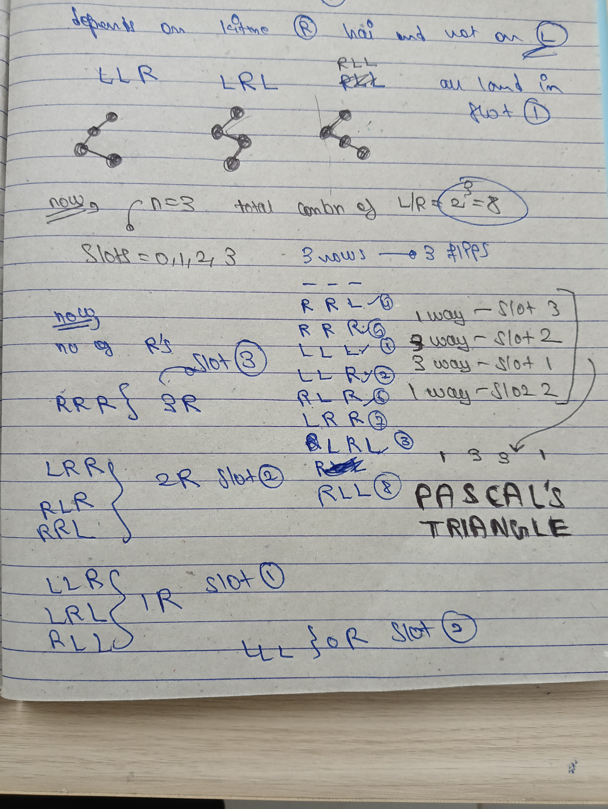
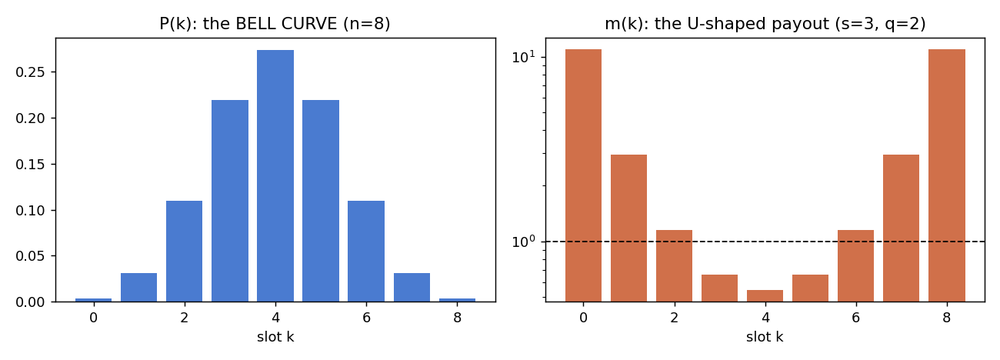
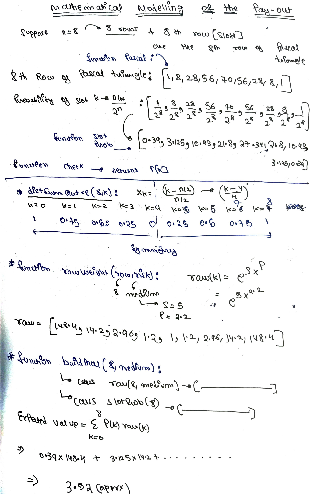
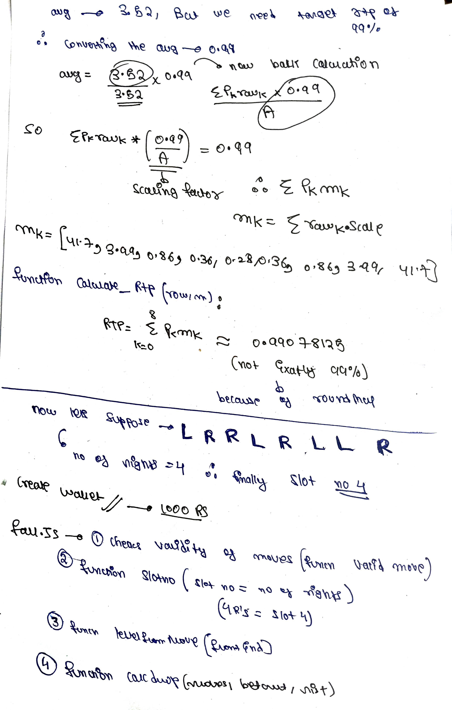
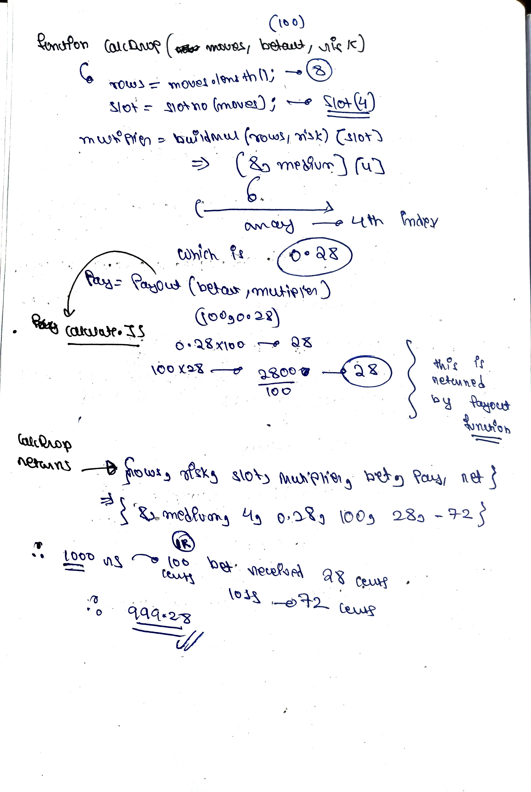

# Maths behind the classic PLINKO game:

i started with writting the possible combination of left and rights, because at each row we have a binary choice between L/R.

and it beautifully turns out to be PASCAL'S TRIANGLE in DISGUISE

Row 0:           1
Row 1:         1   1
Row 2:       1   2   1
Row 3:     1   3   3   1
Row 4:   1   4   6   4   1

then we find out that every slot no depends of the no of rights.

# SLOT PROBABILITY :
**P(k) = nCk/2^n**
k=slot no/no of rights

# Distance from centre :
**X = (|k-n/2|)/(n/2)**
because of the symmetry we start from middle(n/2)
k = distance from centre;

(why did we normalize ? if we dont then it will depend on the no. of n if we have n=10 or n=100 it will have diff values and it becomes difficult for us to map it out, hence the normalisation)

# Binomial distribution :
**P(x=k) = nCkp^k(1-p)^n-k**
The probability p(x=k) that our random outcome x ends up exactly equal to a specific slot k.

what happens when we plot the probabilities vs slots ??
We get a symmetrical curve which mimicks the iconic **BELL CURVE** which gives an insight on why we are more likeley to hit the center than the edges (and the casinos love it :)

# RAW WEIGHT's
**raw = e^(s.x^p)**
s = controls the steepness of the curve, if s = 0 then we get same payout in each slot(which we dont want!)
x = normalized distance we used above;
p = controls the sharpness of the curve, increasing p makes the curve flat near the centre and hence even payout;

# RTP (return to player) :
raw weights are just *shapes*, they are not payouts yet. if we directly use them as multipliers the house could be losing money (or taking too much), so we need to **scale** them so that the game pays back exactly what we want in the long run.
 
**RTP = Σ P(k) · m(k)**
m(k) = final multiplier of slot k
P(k) = nCk/2^n (the probability from above)
it is just the EXPECTED VALUE of the multiplier = (chance of landing) × (what it pays), added over all slots.
 
if RTP = 0.96 then for every ₹1 bet we get back ₹0.96 on average, and the house edge = 1 - RTP = 4%
 
## Hit frequency
chance that the player gets back at least their bet :
 
**hit = Σ P(k) for all slots where m(k) ≥ 1**
 
for the n = 4 example above only the two edges pay ≥ 1x (the 0.98x slots dont count), so hit = 2/16 = 12.5%.
## Scaling :
we want multiplier to keep the shape of raw (edges high, centre low) so we just multiply every raw by a constant c :
 
**m(k) = c · raw(k)**
 
put this in the RTP formula :
RTP = Σ P(k) · c · raw(k) = c · Σ P(k) · raw(k)    (c is constant so it comes out of the sum)
 
hence,
 
**c = RTP / Σ P(k) · raw(k)**
 
so the steps are :
1. find x for every slot
2. raw(k) = e^(s.x^p)
3. find Σ P(k) · raw(k)
4. c = target RTP / that sum
5. m(k) = c · raw(k)

# example :
the centre might pay 0.36x (you LOSE most of the time there) and the edges might pay 2.67x but are super rare, that is the bell curve and the casino working together :)

# 7. RISK LEVELS (low / medium / high)
the "risk" button in a Plinko game is nothing but a different **s** (and/or q) with the SAME RTP. bigger s = edges pay MUCH more, centre pays MUCH less.

## Payout modelling (my handwritten working)

